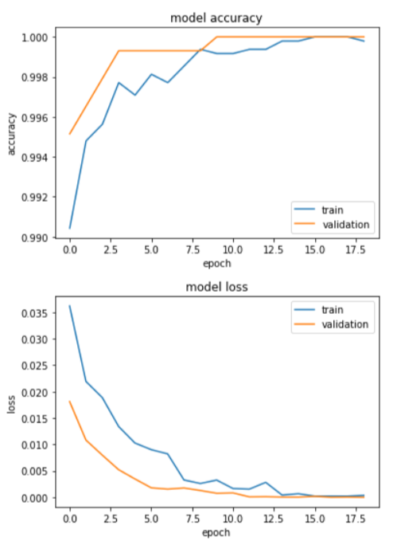
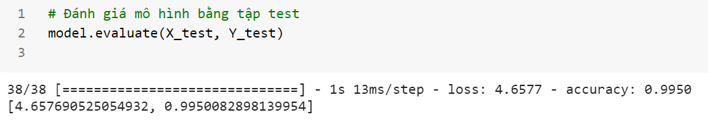
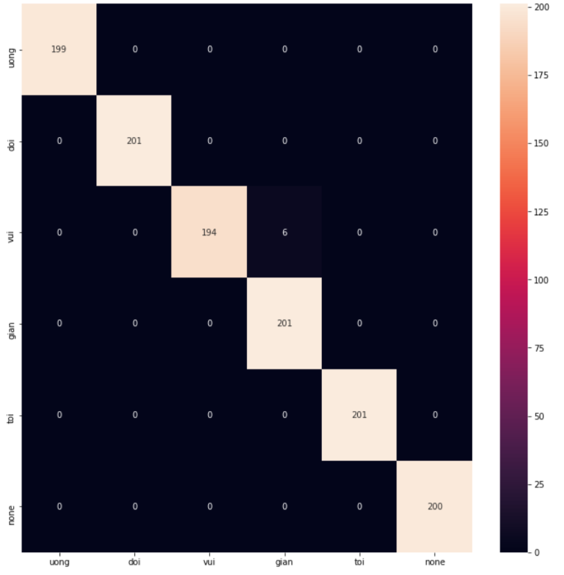

# Real-Time Edge AI Sign Language Recognition using MHI + 2D-CNN

[](#1-academic-verification--context)
[](https://www.python.org/)
[](https://www.tensorflow.org/)
[](https://opencv.org/)
[](#3-hardware--performance-benchmarks)
[-informational.svg>)](#3-hardware--performance-benchmarks)

> **Abstract:** A resource-efficient spatial-temporal gesture recognition pipeline designed for embedded Edge AI execution. By compressing a video stream into a **Motion History Image (MHI)** before spatial classification with a lightweight 2D Convolutional Neural Network (CNN), the system was deployed for real-time recognition on a **Raspberry Pi 4 CPU** without a 3D-CNN or GPU acceleration. **MHI is the enabling front-end of this system:** it lets a compact 2D-CNN consume temporal information within the compute and memory envelope of a single-board computer.

---

## 1. Academic Verification & Context

* **Thesis Title (official, Vietnamese):** *Thiết bị nhận dạng ngôn ngữ ký hiệu cầm tay dành cho người khuyết tật*
  (English: *A Handheld Sign Language Recognition Device for People with Disabilities*)
* **Task statement:** Build a CNN-based sign language recognition model on the Raspberry Pi 4 platform.
* **Institution:** Ho Chi Minh City University of Technology (HCMUT), Faculty of Applied Science, Department of Biomedical Engineering Physics
* **Degree Program:** B.Eng. in Engineering Physics (Biomedical Engineering Specialization)
* **Supervisor:** Dr. Nguyễn Trung Hậu
* **Period:** 28 February 2021 – 18 June 2021
* **Capstone Evaluation Grade:** **9.17 / 10.0** (Evaluated by Academic Council)
* **Authors:** Phạm Hồng Phát ([phatpham.work](https://phatpham.work)) and Huỳnh Thế Nhân
* **Full thesis (Vietnamese, 54 pages):** [LVTN_Phạm Hồng Phát _1712577_Huỳnh Thế Nhân_1712427.pdf][thesis]

Page numbers cited as “p. N” in this README refer to that PDF.

[thesis]: LVTN_Phạm%20Hồng%20Phát%20_1712577_Huỳnh%20Thế%20Nhân_1712427.pdf
---

## 2. System Architecture


> **Why MHI is load-bearing for this pipeline:** A video stream is fundamentally a time series. Direct classification forces one of two costly alternatives: running an independent CNN on every frame (which discards the temporal structure, i.e. the direction and dynamics of the gesture), or applying a 3D-CNN / ConvLSTM over a sliding temporal window, whose compute and activation memory scale with the temporal depth. MHI collapses the motion history of a gesture into a single 2D plane, so a compact 2D-CNN can consume temporal information at the camera frame rate. This compression is what made accelerator-free video inference practical on a single-board computer.

### Mathematical Formulation: Motion History Image (MHI)

Temporal motion is encoded into a single 2D spatial representation where pixel intensity decay represents motion recency ([thesis][thesis], §2.4, pp. 23–26):

$$
H_{\tau}(x, y, t) = \begin{cases} \tau & \text{if } \Psi(x, y, t) = 1 \\ \max(0, H_{\tau}(x, y, t - 1) - 1) & \text{otherwise} \end{cases}
$$

Where:

* $\Psi(x, y, t)$ is a binary frame-difference mask calculated via $\lvert I(x,y,t) - I(x,y,t-1) \rvert > \xi$ (grayscale difference, $\xi = 50$).
* $\tau$ is the temporal history window in frames. The thesis used $\tau = 5$ s at 30 fps, so the default is `tau_frames: 150`.
* $H_{\tau}(x, y, t)$ is rendered as $I = H_{\tau} / \tau \times 255$: bright pixels represent recent movement and darker gradients encode trajectory history. The MHI is single-channel internally and replicated to 3 channels to match the trained CNN input.

> **Implementation note:** [src/mhi.py](src/mhi.py) implements this equation directly with NumPy and OpenCV core, without `opencv-contrib`. The thesis code used wall-clock timestamps through `cv.motempl` (Appendices 1 and 3, pp. 46–53); both are equivalent at a steady 30 fps, but the frame-based form decays more slowly if the loop runs below 30 fps. The thesis text specifies $\tau = 5$ for capture and testing (pp. 29, 37), whereas the capture listing sets `MHI_DURATION = 3` (p. 46), and the real-time listing sets `MHI_DURATION = 5` (p. 51).

MHI was first proposed by [A. Bobick et al.](https://ieeexplore.ieee.org/document/910878) as a method to capture both spatial and temporal information of an action. Since sign languages consist of dynamic gestures, this spatial-temporal encoding makes it possible for a static 2D-CNN to recognize actions, not just still images.


### Gesture Classes

Six classes covering the most basic vocabulary needed in daily life, including a `None` class indicating no action:

+ Uống (Drink)
+ Đói (Hungry)
+ Vui (Happy)
+ Giận (Angry)
+ Tôi (Me)
+ None (No action)


---

## 3. Hardware & Performance Benchmarks

All values below are reported in the thesis.

### Thesis-reported deployment (Raspberry Pi 4)

| Item                           | Value                                                                                                                                | Source            |
| :----------------------------- | :----------------------------------------------------------------------------------------------------------------------------------- | :---------------- |
| **Embedded target**      | Raspberry Pi 4 Model B: Broadcom BCM2711, quad-core Cortex-A72 @ 1.5 GHz, 4 GB LPDDR4. The documented setup includes no accelerator. | pp. 14–17        |
| **Peripherals**          | OV5647 5 MP camera module, 3.5" 320×480 touchscreen                                                                                 | pp. 15–16        |
| **Camera input**         | 320×240 ROI at 30 fps; MHI with $\tau = 5$ and $\xi = 50$                                                                       | p. 29             |
| **Dataset**              | 6,006 MHI images captured on the Pi, 6 classes, resized to 160×160                                                                  | p. 30             |
| **Model**                | 4 conv blocks + 1,066-unit dense layer, **1,805,020 parameters** (Keras)                                                       | pp. 33–34        |
| **Training**             | Google Colab, batch size 32, 20 epochs, RMSprop + `ReduceLROnPlateau`                                                              | p. 34; pp. 47–51 |
| **Offline accuracy**     | **99.5%** on the held-out test set (`accuracy: 0.9950`); 6 `Vui` samples misclassified as `Giận`                        | pp. 35–36        |
| **Real-time evaluation** | Run live and assessed qualitatively. Predictions respond quickly to sign changes, but fluctuate between classes.                     | pp. 37–39        |

The thesis does not report per-frame latency or memory measurements. The “30.0 fps” overlay in its real-time screenshots (pp. 37–39) is the camera's configured rate from `cam.get(cv.CAP_PROP_FPS)` (p. 53), not measured loop throughput.

> **Class count:** The English abstract (p. 11) mentions 27 sign classes. The reported 99.5% result is for the 6-class model (pp. 30–36). An earlier 25-class model trained well, but performed poorly in real time and was replaced (pp. 27, 39).

Empirical validation from the thesis (Figures 35–37, pp. 35–36):

|                Learning Curve                |                Test Evaluation                |                 Confusion Matrix                 |
| :------------------------------------------: | :--------------------------------------------: | :----------------------------------------------: |
|  |  |  |

---

## 4. Key Engineering & Dependable AI Features

* **System-Level Enabling of Edge Deployment:** Gestures are inherently temporal, yet the deployment target is a CPU-only single-board computer. MHI encodes each gesture's motion trajectory into a single spatial frame, which allows a compact 2D-CNN to run on the Raspberry Pi.
* **Bounded Temporal Memory:** The temporal state is one `uint8` MHI plus the previous frame (≈ 307 KB at 320×240), independent of the history length $\tau$. A sliding-window 3D-CNN instead buffers $\tau$ frames.
* **Low Preprocessing Cost:** The MHI update needs only a few vectorized NumPy / OpenCV-core operations per frame, and it does not require `opencv-contrib`.
* **Accelerator-Free Deployment:** Deployed on a Raspberry Pi 4 CPU with no GPU HAT, NPU, or co-processor.
* **Modular Infrastructure:** Dataset loading, MHI extraction, model definition, training, live inference, and benchmarking are separated into a typed package and configuration-driven CLIs.

### Known Limitations (from the thesis, §4.3 and Ch. 5, pp. 39–43)

* **Low spatial detail:** MHI blurs small finger movements, so finger-level signs are poorly represented.
* **Single frontal camera:** Depth information is lost, and overlapping motions overwrite each other. The thesis suggests multi-camera setups or combining MHI with Motion Energy Images (MEI).
* **Trajectory similarity:** Signs with similar trajectories produce correlated MHIs. The thesis measured Pearson $r = 0.3553$ for `Vui`/`Giận`, and up to $r = 0.6075$ for pairs in the abandoned 25-class model.
* **Real-time stability:** Live predictions were not yet stable enough for continuous sign-to-text translation.

---

## 5. Getting Started

```bash
python -m venv .venv && source .venv/bin/activate
pip install -r requirements.txt   # exact verified versions
pip install -e .                  # installs the `src` package used by the scripts

python scripts/benchmark.py                      # MHI + inference latency
python scripts/live_inference.py --source 0      # webcam / PiCamera (needs a display)
python scripts/train.py --data-dir data/processed_mhi
```

All parameters, including camera size, $\tau$, $\xi$, model input, training hyperparameters, and class IDs, are configured in [configs/default_config.yaml](configs/default_config.yaml).

**Dataset:** The thesis dataset is not distributed. [scripts/train.py](scripts/train.py) expects MHI images (grayscale or RGB, any size) anywhere under `data/processed_mhi/`, labelled by the first two characters of the filename:

| Prefix | Class          | Prefix | Class         |
| :----- | :------------- | :----- | :------------ |
| `uo` | Uống (Drink)  | `gi` | Giận (Angry) |
| `do` | Đói (Hungry) | `to` | Tôi (Me)     |
| `vu` | Vui (Happy)    | `no` | None          |

Files starting with `.` or `C_` are skipped. `data/raw/` is reserved for source recordings.

---

## 6. Repository Structure

```text
.
├── assets/                   # Thesis evaluation figures
├── configs/
│   └── default_config.yaml   # Camera, MHI, model, training & class configuration
├── data/                     # Dataset directory (git-ignored)
│   ├── raw/
│   └── processed_mhi/
├── models/
│   └── cnn_mhi_model.h5      # Trained weights (1,805,020 params, as in the thesis)
├── src/                      # Core Python package
│   ├── __init__.py
│   ├── dataset.py            # MHI image loading & labelling
│   ├── mhi.py                # Frame-decay Motion History Image engine
│   ├── model.py              # Keras 2D-CNN architecture definition
│   └── utils.py              # Config, preprocessing, FPS & overlay helpers
├── scripts/
│   ├── benchmark.py          # MHI & inference latency benchmark
│   ├── train.py              # Training, evaluation & confusion matrix
│   └── live_inference.py     # Real-time webcam / PiCamera pipeline
├── pyproject.toml            # Package metadata, dependency ranges, Ruff config
├── requirements.txt          # Exact verified dependency versions
└── README.md
```
